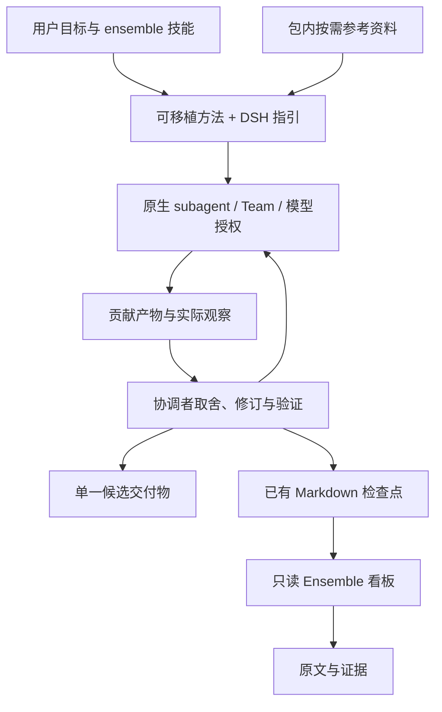

# Ensemble 面向新版 DSH 的适配设计

**结论：ensemble 保持可移植的方法核心，用新版 DSH 原生 subagent 树与 Team 任务板承载执行；专用插件实现用户技能入口、包内参考资料读取，以及已有 Markdown 的只读看板。** 原生模型选择已满足基础需求，不再开发旧 Team 兼容层，也不新增 `ensemble_spawn`。

这是实施设计，不是已实现功能。本轮建立可写源码副本、拉取官方上游并复核接入接口；没有安装插件、修改现行 skill 或替换当前 GUI 构建。具体 Module 与交付顺序见[插件实现设计](<PLUGIN-IMPLEMENTATION-DESIGN.md>)，原生执行契约见[执行适配设计](<EXECUTION-ADAPTER-DESIGN.md>)。

## 1. 固定目标与证据

目标提交为 `39163dd30f703a79079e2d2446545cff3c453738`，副本在[可写 DSH checkout](<../../.scratch/extra-src/deepseek-harness>)。官方 `master` 拉取成功，`HEAD/origin/master/FETCH_HEAD` 与远端 `HEAD` 一致；相对上一轮研究新增提交为 **0**。本轮变化是用户选定新版专用目标，不是发现了额外上游变更。[源码基线](<UPSTREAM-BASELINE.md>)记录命令、版本标识和原件保护。

| 依据 | 本轮用途 |
|---|---|
| [新版执行复核](<NEW-DSH-EXECUTION-RESEARCH.md>) | 原生创建、模型/effort/preset、Team mode、通信与恢复的支持矩阵 |
| [新版 Client 与交付复核](<NEW-DSH-PLUGIN-RESEARCH.md>) | 看板入口、文件读取、安全呈现、仓外打包与验收 |
| [多维异构复核](<HETEROGENEITY-RESEARCH.md>) | 保留同模型差异的价值，区分配置与实际请求证据 |
| [方法与历史复核](<METHODOLOGY-RESEARCH.md>) | 区分方法价值、流程选择与 OMP 实现细节；模型优先措辞以多维复核为准 |
| [设计术语](<GLOSSARY.md>) | 区分 Member、Attempt、Contribution、独立性、异构性与冗余 |

本次确实使用具名 Agent Teams：execution 与 dashboard 分别承担执行链和 Client 复核，Lead 负责基线、Host 资源和整合。成员均为 `gpt-6-astra`；后续复核属于原研究的接续，不伪计为新的独立样本。当前运行工具仍是旧形态，这只影响本次研究的操作方式，**不决定目标设计**，也不构成新版跨模型或 effort 运行验收。

历史[旧 Team 选型研究](<TEAM-MODEL-SEAM-RESEARCH.md>)与[运行时/源码差异记录](<INTEGRATION-RESEARCH.md>)保留供追溯，不再进入实现范围。

## 2. 稳定的方法核心

Ensemble 利用至少两个独立尝试的实质差异或有意冗余，得到可比较或互补的贡献，再依据证据取舍、修订和验证，形成一个完整交付。它不是普通多人分工的别名，也不是固定投票、固定角色流水线或全员一致制度。

**按问题选择有用的差异；关键判断可能受共同模型盲点影响时，优先加入可用、获准且适任的不同模型。** 同模型不同提示、方向、方法、工具或真实推理强度本身可以有价值，不一概称为降级；只有明确需要的能力缺失时，才相对此计划说明损失。

| 差异来源 | 可能改变什么 | 不能自动保证什么 |
|---|---|---|
| 模型 | 先验、能力、习惯和共同错误模式 | 不同别名实际指向不同模型，或结论一定更好 |
| 提示、方向、方法 | 问题分解、搜索路径、取舍和反例构造 | 换句式就产生实质差异，或消除共同模型盲点 |
| 工具、知识、证据来源 | 可获得的观察与可执行的验证 | 角色名声称的能力实际存在 |
| reasoning effort | 所选路由支持的推理控制设置 | 实际算力、质量提升或跨模型等强度 |

异构性回答“有什么实质差异”，冗余回答“是否重复观察同一问题”，独立性回答“初始判断前接触了什么”。两个模型回答同一问题可以同时异构且冗余；同模型的协议追踪与故障反例搜索也可能形成有效组合。产出是否有用最终由观察决定。

| 应保留的价值 | 可随 harness 调整的策略 |
|---|---|
| 在初始判断前减少对别人成果的锚定 | fresh、受控 fork、尚未接触该问题结论的持久成员 |
| 证据驱动取舍和修订 | 竞争设计、互补研究、测试先行、反例搜索的组合 |
| 一个完整交付目标与可识别候选 | 谁调查、谁实现、谁整合；coordinator 可以亲自工作 |
| 检查覆盖真实候选 | 设计、研究、代码的验收项分别安排 |
| 关键判断和下一步可恢复 | 普通 Markdown、原生 Session、产物指针；不强制每次更新都提交 Git |
| 并行写入不相互破坏 | 分离写范围、单候选 owner、竞争实现隔离基线 |

现有 OMP adapter 的状态写入机制不应限定方法论；但也不把所有流程规则都归因于 OMP 技术限制。有些是方法作者的选择。正式修订保留其保护的价值，删除已由原生能力承担的负担，不恢复早期的 coordinator 禁止实现、机械上报或 write-proxy 约束。

## 3. 持久协作与独立尝试如何共存

Member 是可复用参与者；Attempt 是围绕明确问题和输入基线的一次有界尝试；Contribution 是其可用于改进交付的产出。一个成员可多轮修订同一贡献，也可参与多个问题；新任务号、新名字和新会话都不能自动增加独立样本数。

| 目的 | 合适的上下文 | 贡献的解释 |
|---|---|---|
| 获取关键方案的独立初判 | 默认 fresh，给共同事实、中性问题与同等基线 | 未接触比较对象论证时可作为独立尝试 |
| 原作者修复确认的问题 | 续聊，保留失败经验 | 既有贡献的修订 |
| 原审查者重验复现 | 续聊，指明候选变化 | 针对性重验，不是新的全面盲评 |
| 新问题需要另一份 readiness 判断 | 新上下文或已知未接触相关结论者 | 检查共同前提与当前候选 |
| fork 仅继承需求与原始材料 | 依据实际继承内容判断 | 有历史不等于已继承答案 |

fresh 可能被带结论的 prompt、共享报告、任务板或正在改动的代码锚定；“请忘记”也不会清除旧上下文。普通任务包不必记录逐句话的信息传播图；真正强制盲评需要另外设计访问隔离，原生 fresh/Team 协议不提供这个保证。

新版 Team 是同一 subagent 树上的任务协作功能，不是独立的代理种类。持久成员可以保留实现经验，关键决策时按需增加新的独立尝试；初步结果形成后允许交流和相互质疑，没有固定代数或每阶段销毁成员的要求。

## 4. 原生执行优先，专用插件不重复运行时

新版原生工具已经覆盖命名、逐子代理模型与 effort、允许 preset、发现、消息、续聊和恢复。执行选择 Adapter 的 Implementation 是**原生配置组合与 DSH 专用指引**，不是自写的授权逻辑或转发工具。

必须在交付中说清楚：标准 spawn 开启选型，fork 未开启；独立 preset 由 spawn 支持、fork 不支持；标准 interrupt 未暴露；Team 默认关闭；模型允许列表作用于新根 Session 且不回溯旧 Session。不能把源码具有能力误写成每个 preset 都暴露该能力。[执行适配](<EXECUTION-ADAPTER-DESIGN.md#L21-L53>)给出精确矩阵。

选型省略也有差别：全省略保留原生默认/继承；显式 provider+model 但省略 effort 则采用 route 默认，即使选回同一模型也是如此。用户授权、部署默认、模型显式选择三者不混同。插件不借受信默认或底层 activation 绕过工具策略。

实际请求证据与配置声明分开：普通 `list_agents` 不返回模型/effort；descriptor 也不能证明实际请求采用值。方法记录有证据的事实，未核对则明确写成请求配置。看板不推断缺失模型，更不从角色名或答案篇幅生成异构徽章。

## 5. Module、Interface 与职责

这些是信息与工作关系，不是固定执行阶段。

| Module | 自有 Interface | Implementation 与复用 Seam |
|---|---|---|
| 可移植方法 | 人可读的技能、术语、模式与模板 | 不包含 DSH 专属工具 schema；保留 OMP 消费 |
| Host 技能与参考资料 | 用户 `/ensemble`；只读 `ensemble_reference(document)` | 原生 skill provider/invocation policy；固定包内文档读取；核心与模板随用户调用加载 |
| DSH 执行适配 | 对原生工具的任务指引和配置示例 | 复用选型、授权、subagent、Team；不另造 spawn/control API |
| Client 看板 | 打开既有检查点文件；看板/原文/刷新/证据 | 外层 sidebar resource tab、workspaceFiles、file resource/useResource；无写入和调度入口 |

Host 的 Depth 在于隐藏安装目录与容器文件世界的差异，给模型一个小的参考资料 Interface；Client 的 Depth 在于隐藏资源寻址、刷新、取消、容错解析与安全打开证据。原生 Seam 提供 Leverage；DSH 特有知识集中在 adapter 内获得 Locality。若删除适配模块，不应让 OMP 消费者重新承担 DSH 生命周期或浏览器构建知识。

## 6. 看板只整理现有 Markdown

第一版只做当前文件的专用侧栏资源 tab。用户从文件链接或浏览器打开 `.ensemble/<NNN>-<slug>/STATE.md` 就进入对应视图；同一 tab 可切到字面原文。普通 Markdown 继续走原有 viewer，不注册全局 `md` 内层预览器，不建设全屏历史应用。

| 看板区域 | [现有模板](<../../skills/ensemble/STATE-TEMPLATE.md>)中的来源 |
|---|---|
| 目标与范围 | Lifecycle、Requested deliverable、Subject、Required coverage |
| 尝试与实质差异 | Contributions 表；窄侧栏可按 Attempt 展为卡片 |
| 取舍与发现 | Decisions and findings |
| 候选和验收缺口 | Candidate and verification |
| 下一步 | Next |

现有差异单元格可用普通文字记模型、方法和上下文；不要求新列、机器标签或隐藏元数据。未知段落与不能解释的结构不能消失；缺信息保持未知。`returned`、task completed、已采纳和已验证是不同事实。

读文件以源地址为准，不以当前选中 Session 或 Host cwd 猜位置。获得绝对目标后，内容读取、metadata 订阅与证据基址绑定同一资源；切换 Session、删除重建、重连和慢请求都不能把别处内容显示成当前文件。自动刷新仅为尽力的变化检测，始终保留直接重读的手动刷新并标为文件快照。

容错解析采用成熟 GFM parser，不手写表格正则或要求作者迁移格式；看板保守绘制语义内容，原文始终可见。默认不加载远端图片、不运行 HTML；证据点击按明确允许的 URI 类型处理。公开 Markdown primitive 不自动保证严格 URL allowlist，不能据“复用安全渲染”省略这些决定。

文件权限继续走既有浏览器文件接口，它不等同于 agent 工具 sandbox。路径识别只决定是否显示看板，不是安全隔离。原生文件接口、时序、资源管理和安全测试详见[Client 复核](<NEW-DSH-PLUGIN-RESEARCH.md>)。

**没有新的 invocation JSON/YAML、frontmatter、schema version、索引文件或数据库。** 解析后的内存对象只是视图 Implementation，不成为 agent 写入协议。DSH 原有 bundle/preset 配置属于插件安装组合，不是新增 ensemble 状态格式。

## 7. 写入、事实来源与恢复

| 事实 | 权威来源 | 检查点的用途 |
|---|---|---|
| 成员身份、消息、运行与终止 | 原生 subagent/Session | 保存必要引用，不用 Markdown 控制运行 |
| 任务 owner、revision、依赖 | 原生 Team | 需要时引用任务，不维护逐字段镜像 |
| 贡献采纳、取舍与缺口 | 协调者依据真实证据作出的判断 | 保留当前摘要与依据 |
| 候选与检查事实 | 实际产物、diff、执行结果和测量 | 指向实际观察对象；候选变了就复核适用性 |

协调者更新检查点，原生 read/write 负责文件操作，不照搬 OMP 的 `ensemble_state` 工具。文件原子发布不等于版本冲突保护；观察策略启用时的已读版本检查，也不能推及 bash、所有消费者或所有 backend。Git 提交遵循仓库流程，不再作为每次方法更新的强制仪式。

竞争实现必须有可识别的同等输入和隔离 checkout/可靠副本；worktree 默认从 commit 起步，不自动带入用户未提交修改。互补只读研究无需为了仪式建 worktree。write scopes、不同 cwd 都不是安全沙箱；一个被接受候选由一个 owner 整合，交付前看最终 diff 和验证结果。

恢复时先读目标、判断与下一步，再核对候选、实际产物和原生成员/任务，仅重做缺失或失效部分。成员 inactive 不表示成功，消息受理不表示完成，关闭 Team 不停止成员。卸载插件不接管原生生命周期。

## 8. 已确定的实施范围

1. **方法修订**：更新[技能](<../../skills/ensemble/SKILL.md>)、[现行术语](<../../skills/ensemble/GLOSSARY.md>)、[说明](<../../skills/ensemble/README.md>)与[模式](<../../skills/ensemble/PATTERNS.md>)；用共同方法 + harness 适配表达规则，保留[状态模板](<../../skills/ensemble/STATE-TEMPLATE.md>)的普通 Markdown。
2. **Host 实现**：新增 DSH skill provider 和有界、固定 document enum 的参考资料工具；保留用户触发策略，不把协调者方法自动灌给每个成员。
3. **Client 实现**：专用资源 tab、单个只读文件快照、语义看板/原文切换、刷新与证据访问；不新增执行状态。
4. **交付实现**：沿用当前 `@vcup/skills`，保留[OMP 入口](<../../adapters/omp/index.ts>)，增加 bare-package Host 入口、`./client`、原生 bundle 配置与仓外浏览器构建；不依赖本地 scratch 路径分发。
5. **验收**：真实 Loader 组合、model-visible snapshot、发布包闭包、既有 Web GUI 和 OMP 回归；多模型与 effort 的真实请求另用获准 Adapter smoke 验证。

具体拟新增目录、接口、依赖、失败行为、拆分顺序和完成标准均在[插件实现设计](<PLUGIN-IMPLEMENTATION-DESIGN.md>)。不再把“是否实现专用插件”留作开放选择；只保留授权路由、可用 preset 和真实运行环境等部署选择。

本轮交付的是可实施的新版专用方案与证据，不把静态阅读当成运行通过。当前方法文件、包入口与原件均未改，用户已有暂存工作保持原样。
