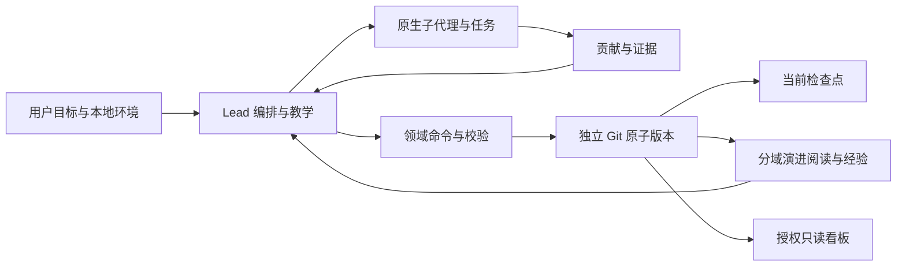

# Ensemble：领域与插件设计

**本页是完整产品的设计契约，不是完成声明。** `dsh-ensemble@1.0.0` 已实现领域工具、统一档案执行器、owner Remote、CLI 与 Client，验证状态按门列在[生产交付设计与验收](../PRODUCTION.md)；早期 probe 阶段的历史证据见 [P1 交付记录](P1-DELIVERY.md)。新增能力必须经过完整旅程、故障与双版本验收，不能继承早期阶段的成熟度判断。可移植方法见[技能](../../skills/ensemble/SKILL.md)与[方法术语](../../skills/ensemble/GLOSSARY.md)，托管概念见[项目词汇表](../../GLOSSARY.md)，OMP 保留其[现有使用方式](../../adapters/omp/README.md)。

设计接入基线固定为正式标签 `dsh-v0.2.2-rc.4`，提交 `3f321d32bfe382212a8ed8785c1d47a5a300aa23`；当前受测 DSH 版本集合、默认版本与升级流程见[版本支持与升级](../UPGRADING.md)，本节固定源码依据不因支持集合扩大而改写。已核对[源码包清单](https://github.com/deepseek-ai/deepseek-harness/blob/3f321d32bfe382212a8ed8785c1d47a5a300aa23/package.json#L1-L9)和[npm 精确版本](https://registry.npmjs.org/@deepseek-ai%2Fdsh/0.2.2-rc.4)。核验时 `next` 指向该版，但可变标签不作为可复现依赖。开发分支即使包版本相同，也不能替代发行源码的接口依据；已确认发布不等于本插件完成安装或运行验收。支持该基线的统一subagent树。此前核验的npm `latest`指向rc.1；该版仍使用[独立具名Team创建入口](https://github.com/deepseek-ai/deepseek-harness/blob/dsh-v0.2.2-rc.1/packages/experimental/tool-agent-team/src/index.ts)，不属于本适配目标。具体部署的模型/provider/effort、端点与凭证不属于本仓库。

**目标：让适任的强 Lead 主要负责编排、教学与关键判断；工作模型承担明确贡献；程序管理工作区外的协调事实、历史和知识出版，逐步积累值得精读、能用于后续工作的经验。** Lead 可以直接研究或实现，但不能用自己包办替代对成员工作方式的改善，也不因模型更强而免于证据检查。

## 当前架构决定

插件模式下，不创建工作区内的 `.ensemble/`，也不要求模型编辑状态 Markdown、分配序号或运行 Git。模型调用领域工具表达意图与证据；程序验证身份、引用和状态转换，生成检查点与阅读文档，并在独立仓库中自动版本化。普通 Markdown 仍是人可读输出；结构化私有记录由插件拥有版本，不变成模型手写的新文件协议。

这取代早期“只用 workspace 文件工具、专用只读 Markdown 看板即可”的范围。旧文件浏览可作为一次性迁移预览；新看板读取经过授权的 Archive Interface，不通过任意 Host path，也不依赖容器能读插件安装目录。纯 skill/当前 OMP 仍按自己的能力使用隔离记录区，不能宣称已经具有该功能。

| 模型与职责 | 拥有的事实 | 不推导的事实 |
|---|---|---|
| 原生执行 | agent、task、model request、message、运行生命周期 | 贡献是否被采纳、是否已学会方法 |
| 协调 | 目标、覆盖、尝试、贡献、取舍、候选与验证声明 | 原生 task completed 不自动等于贡献 accepted |
| 学习与出版 | 教学干预、反思、经验适用性、分域阅读、修订关系 | 时间先后不自动等于因果，写入不等于学习生效 |
| 环境选择 | 本地 role 偏好、原生允许的 route/effort/preset 选择 | 偏好不授予权限，不提供模型能力的全局排名 |
| 历史存储 | 被接受命令的版本、原子发布、恢复与可读投影 | Git commit 不证明实现正确、外部证据仍可用或远端备份成功 |

| 读者要做什么 | 负责文档 |
|---|---|
| 理解对象、教学与知识复用 | [领域模型](DOMAIN-MODEL.md)与[方法术语](../../skills/ensemble/GLOSSARY.md) |
| 选择并驱动原生代理 | [原生代理接入](NATIVE-AGENTS.md) |
| 实现工具字段、权限、状态、查询和错误 | [命令约定](COMMANDS.md) |
| 实现原子提交与Host隔离 | [档案设计](ARCHIVE-DESIGN.md) |
| 配置、导入导出、备份恢复与维护 | [运行管理](OPERATIONS.md) |
| 逐步走读用户操作及界面 | [用户旅程](USER-JOURNEYS.md) |
| 核对旧内容每项如何替代 | [表达矩阵与样例](REPLACEMENT-MAP.md) |
| 分配实现与验收 | [实施准备](IMPLEMENTATION.md)及[路线图](../../ROADMAP.md) |
| 隔离纯skill、OMP、DSH的安装和使用内容 | [三路径分发设计](DISTRIBUTION.md) |
| 核对实现范围、门覆盖与仍待验收的项目 | [生产交付设计与验收](../PRODUCTION.md)、[路线图](../../ROADMAP.md)；历史阶段证据见 [P1 交付记录](P1-DELIVERY.md) |
| 在本仓库运行构建、检查、测试与打包 | [开发环境与操作指南](../../docs/DEVELOPMENT.md) |
| 查研究依据、审阅反例与判断变化 | [研究索引](research/README.md)及[设计演进](EVOLUTION.md) |

箭头表示信息交接，不是固定角色流水线。编排不会被存储实现接管，学习模块也不会私自启动新模型回合。

## 一条完整使用路径

以下八步是目标流程与验收语义。它们已经实现为随包发布的工具、外置 archive、owner Remote 与 Client，但**完整验收尚未完成**：逐门证据与仍待验收项见[生产交付设计与验收](../PRODUCTION.md)。本页表述的是应当成立的行为，不是“已经全部验收”的声明。

1. 用户在 Host 配置私有档案根与项目绑定。托管写入始终自动版本化；停用档案后停止写入。凭证继续由 DSH 管理，环境偏好在独立仓库保存。
2. 用户调用 ensemble；Lead 通过 `open` 建立目标和覆盖。工具返回 invocation 身份及 revision，程序已生成初始检查点并保存版本。
3. Lead 按需检索适用经验，核对实际可选 provider/model/effort，为工作模型安排中性任务包与早期可审产物；创建、消息和任务仍走原生工具。
4. 成员通过工具提交贡献摘要和证据引用。程序保留提交者与信息来历；Lead 判定采纳或退回，并针对真实问题提交教学干预。
5. 修订与未教过的案例验证分别记录；非作者检查关键交接。原例修复、迁移能力、完整交付是三个不同结论。
6. Lead 选定 candidate、登记观察范围和未完成验证，然后关闭 invocation；不足条件被明确拒绝或保留为未完成，程序不凭任务状态自动验收。
7. 在判断发生重要变化时，Lead 提交反思提案，引用具体贡献、决策和检查。审阅后发布为分域阅读；经验可从中提炼，但需单独注明适用/失效条件。
8. 后来者按领域和问题读概览、必要章节及证据，在新任务中验证经验；反例可撤回推荐并追加修订，保留旧记录。

每一步的实际成功点都在领域命令和存储返回中可见。未启用 archive 时不悄悄写回主仓库；未获准模型不可借配置偏好绕过原生授权。

## 从外来演进日志采纳的方法

用户提供的另一个项目日志是方法启发，不是本项目已经完成的工作或测试。以下经验已转成可检验设计，而不是复述那个项目的网络/TLS/Rust 结论。

| 经验 | 本设计中的应用 | 如何反驳它是否落实 |
|---|---|---|
| 先完整正常流程，再补失败 | 从 open 到贡献、验证、反思、检索有明确生产者与返回 | 只看到看板或工具 schema，仍无法完成一次闭环即不通过 |
| 相邻模型不共享全能上下文 | native execution、协调、学习、环境、存储分别拥有事实 | 关闭任务能自动 published lesson，或一次保存能授予新 route，即分工错误 |
| 成对反例检验量词 | 提交前失败/提交后响应丢失；教过的例/未见的例；同 remote/不同项目 | 只测一条成功路径不能建立保证 |
| 源码与自带测试可能同错 | Git 语义参照官方文档，权限参照原生 Interface；学习审阅需独立依据 | “实现就是如此”不能替代要求与独立预期 |
| 早交可审小产物 | 先验证完整命令事务和一种可读结果，再加知识出版/UI | 先做大量样式或抽象而缺端到端证据即偏离 |
| 修复同步定义、流程、向量 | 文件分别归属，验收矩阵回指领域决定 | 旧“仅文件看板”仍被当现行实施目标即不一致 |
| 不夸大历史与审阅功劳 | 回溯声明来源不全，review记录具体反例，未运行向量标注未运行 | 链接数、篇幅或一次通过不算设计/产品完备 |

## 完备程度与边界

目前确定了正常操作、领域事实、权限原则、持久化提交点、学习出版流程和验收向量。实现覆盖内容三路径装配、OMP 独立包、DSH 包的 Host 入口、存档事务、原生身份与执行世界边界、维护、环境账本、打包与标准安装；每一项都有对应的 Make 门，**以门的退出码为准**，见[生产状态](../PRODUCTION.md)。仍待验收的是该页列出的项目：最终候选同字节验收、真实浏览器与已认证 Host 界面、网络副本传输、CI 远端实跑与发布。这些待验证项是实施任务，不以旧 Team fallback 或额外运行时绕开。

产品仓库保存可移植方法、稳定领域设计、代码，以及支持它们的源码研究、审阅处分和设计演进。具体环境偏好、操作流水和未整理的运行草稿保存在私有档案；有长期价值的研究与因果解释整理后进入[研究目录](research/README.md)，随产品共享维护。一个集中档案根可以容纳多个相互隔离的项目仓库；“集约”不等于把所有项目和环境记录混进同一提交流。
